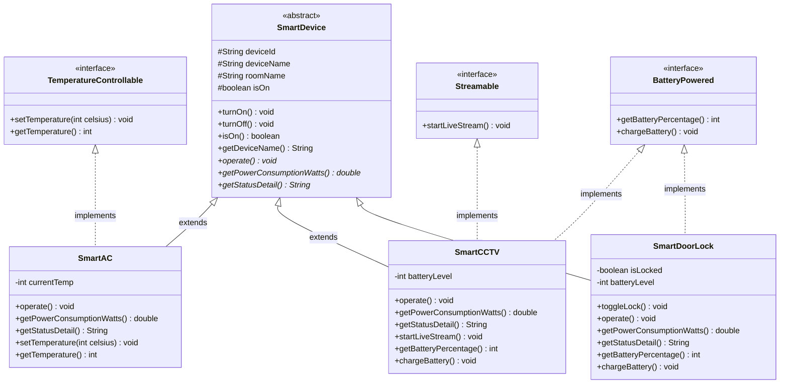

# NusaHome IoT - Smart Home Control System

## 1. Project Overview
NusaHome IoT is a Command Line Interface (CLI) smart home hub simulation built in Java. This project serves as a software architecture case study demonstrating the practical application of core Object-Oriented Programming (OOP) principles: **Abstract Classes**, **Interfaces**, **Inheritance**, **Polymorphism**, and **Encapsulation**.

### Architectural Problem Statement
A unified smart home controller must manage diverse Internet of Things (IoT) appliances from a single dashboard. The system design addresses three primary challenges:
1. **Shared Core Identity:** Every appliance shares baseline attributes (device ID, device name, room location, and power state) and standard power-toggling behaviors.
2. **Divergent Operational Logic:** Each device type executes its primary operation and calculates electrical power consumption differently.
3. **Cross-Cutting Capabilities:** Certain features apply only to specific subsets of devices across the hierarchy. Only air conditioners regulate room temperature, only cameras stream live video, and only specific devices operate on rechargeable batteries.

---

## 2. Project Directory Structure

The codebase is organized modularly into 6 files within the same directory/package:

```text
NusaHomeProject/
|-- DeviceInterfaces.java   # Consolidated capability interfaces (BatteryPowered, TemperatureControllable, Streamable)
|-- SmartDevice.java        # Abstract base class defining shared state and abstract behavior contracts
|-- SmartAC.java            # Concrete class for smart air conditioners
|-- SmartCCTV.java          # Concrete class for smart security cameras
|-- SmartDoorLock.java      # Concrete class for smart door locks
|-- Main.java               # Entry point and interactive Scanner-based CLI controller
```

---

## 3. OOP Concepts: Implementation Breakdown & Code Snippets

This section details how each Object-Oriented Programming concept is implemented, which files contain the logic, and the specific code snippets demonstrating their usage.

### A. Abstract Class & Abstract Methods
* **Where it is defined:** `SmartDevice.java`
* **Where it is extended:** `SmartAC.java`, `SmartCCTV.java`, `SmartDoorLock.java`
* **Architectural Purpose:** `SmartDevice` represents an **"IS-A"** relationship and serves as the foundational blueprint for all appliances. It cannot be instantiated directly (`new SmartDevice()` is forbidden by the compiler). It centralizes shared state (`deviceId`, `deviceName`, `roomName`, `isOn`) and concrete power methods (`turnOn()`, `turnOff()`) to prevent code duplication, while enforcing device-specific behaviors through abstract methods.

**Code Snippet (`SmartDevice.java`):**
```java
public abstract class SmartDevice {
    protected String deviceId;
    protected String deviceName;
    protected String roomName;
    protected boolean isOn;

    // Concrete method: inherited and shared by all subclasses
    public void turnOn() {
        this.isOn = true;
        System.out.println("[ON] " + deviceName + " in " + roomName + " has been turned ON.");
    }

    // Abstract methods: no method body; subclasses are forced to provide their own implementation
    public abstract void operate();
    public abstract double getPowerConsumptionWatts();
    public abstract String getStatusDetail();
}
```

---

### B. Interfaces (Capability Contracts)
* **Where it is defined:** `DeviceInterfaces.java`
* **Where it is implemented:** `SmartAC.java`, `SmartCCTV.java`, `SmartDoorLock.java`
* **Architectural Purpose:** Interfaces represent **"CAN-DO"** relationships (optional, cross-cutting capabilities). Placing methods like `setTemperature()` or `chargeBattery()` inside `SmartDevice` would force `SmartAC` to inherit battery methods (even though it runs on AC mains power) and force `SmartDoorLock` to inherit temperature methods. Isolating these into package-private interfaces adheres to the *Interface Segregation Principle (ISP)*.

**Code Snippet (`DeviceInterfaces.java`):**
```java
interface BatteryPowered {
    int getBatteryPercentage();
    void chargeBattery();
}

interface TemperatureControllable {
    void setTemperature(int celsius);
    int getTemperature();
}

interface Streamable {
    void startLiveStream();
}
```

---

### C. Inheritance (`extends` and `implements`)
* **Where it is used:** Class declarations in `SmartAC.java`, `SmartCCTV.java`, and `SmartDoorLock.java`, plus constructor chaining via `super(...)`.
* **Architectural Purpose:** Subclasses inherit baseline properties and concrete methods from `SmartDevice` using `extends` (Single Inheritance), while binding themselves to one or more capability contracts using `implements` (Multiple Interface Implementation). They fulfill all abstract and interface contracts using the `@Override` annotation.

**Code Snippet (`SmartCCTV.java`):**
```java
// Inherits state/methods from SmartDevice, and fulfills contracts from two interfaces
public class SmartCCTV extends SmartDevice implements Streamable, BatteryPowered {
    private int batteryLevel;

    public SmartCCTV(String deviceId, String roomName, int initialBattery) {
        // Calls the parent (SmartDevice) constructor to initialize shared attributes
        super(deviceId, "Smart CCTV 360", roomName);
        this.batteryLevel = initialBattery;
    }

    @Override
    public void operate() {
        System.out.println("-> " + deviceName + " is actively recording motion in " + roomName + ".");
    }

    @Override
    public void startLiveStream() {
        batteryLevel -= 5;
        System.out.println("[LIVE STREAM] Streaming from " + roomName + " (Battery: " + batteryLevel + "%)");
    }
}
```

---

### D. Polymorphism (Dynamic Dispatch, `instanceof`, and Downcasting)
* **Where it is used:** `Main.java` (inside `main()` and `controlSingleDevice()`)
* **Architectural Purpose:** Polymorphism allows the controller to manage heterogeneous device objects uniformly through a single `SmartDevice` reference type. It is applied in two distinct ways within `Main.java`:

#### 1. Polymorphic Collection & Dynamic Method Dispatch
All concrete devices (`SmartAC`, `SmartCCTV`, `SmartDoorLock`) are stored inside a single `List<SmartDevice>`. When iterating through the list in Menu 1, calling `d.getPowerConsumptionWatts()` and `d.getStatusDetail()` dynamically invokes the specific overridden version belonging to the actual runtime object.

**Code Snippet (`Main.java` - Menu 1 Loop):**
```java
List<SmartDevice> devices = new ArrayList<>();
devices.add(new SmartAC("AC-01", "Master Bedroom"));
devices.add(new SmartCCTV("CAM-01", "Front Porch", 25));
devices.add(new SmartDoorLock("LCK-01", "Main Door", 60));

double totalPower = 0;
for (SmartDevice d : devices) {
    // Dynamic Method Dispatch: resolves to the specific subclass implementation at runtime
    System.out.println(d.getStatusDetail());
    totalPower += d.getPowerConsumptionWatts();
}
```

#### 2. Runtime Type Checking (`instanceof`) & Object Downcasting
In `controlSingleDevice()`, the method accepts a generic `SmartDevice` parameter. To display context-sensitive menu options and invoke interface-specific methods (such as adjusting temperature or charging a battery), the program checks the object's capabilities at runtime using `instanceof` and performs **downcasting** from `SmartDevice` to the target interface.

**Code Snippet (`Main.java` - `controlSingleDevice` Method):**
```java
private static void controlSingleDevice(Scanner scanner, SmartDevice device) {
    // Dynamically render menu options based on implemented interfaces
    if (device instanceof TemperatureControllable) {
        System.out.println("3. Set Temperature (AC Only)");
    }
    if (device instanceof Streamable) {
        System.out.println("4. Start Live Stream (Camera Only)");
    }

    // ... inside the switch-case block for Action 3:
    if (device instanceof TemperatureControllable) {
        int newTemp = scanner.nextInt();
        // Downcasting SmartDevice reference to TemperatureControllable interface
        ((TemperatureControllable) device).setTemperature(newTemp);
    }
}
```

---

### E. Encapsulation & State Validation
* **Where it is used:** Access modifiers across `SmartDevice.java`, `SmartAC.java`, `SmartCCTV.java`, and `SmartDoorLock.java`.
* **Architectural Purpose:** Internal object attributes are shielded from arbitrary external modification. Shared fields in `SmartDevice` use `protected` so subclasses can access them directly while keeping them hidden from external classes. Device-specific fields (`currentTemp`, `batteryLevel`, `isLocked`) are strictly `private` and can only be modified through mutator methods that enforce operational validation rules.

**Code Snippet (`SmartAC.java`):**
```java
public class SmartAC extends SmartDevice implements TemperatureControllable {
    // Private attribute: cannot be modified directly from Main.java
    private int currentTemp = 24;

    @Override
    public void setTemperature(int celsius) {
        // State validation: prevents invalid modifications when device is OFF or out of bounds
        if (!isOn) {
            System.out.println("[FAILED] Please turn ON the AC before adjusting the temperature.");
            return;
        }
        if (celsius < 16 || celsius > 30) {
            System.out.println("[FAILED] AC temperature must be set between 16°C and 30°C.");
            return;
        }
        this.currentTemp = celsius;
    }
}
```

---

## 4. Technical Component Mapping Matrix

The table below summarizes how OOP constructs are distributed across the concrete classes:

| Concrete Class | Superclass (`extends`) | Implemented Interfaces (`implements`) | Encapsulated Fields (`private`) | Overridden Methods | Power Draw (ON / Standby) |
| :--- | :--- | :--- | :--- | :--- | :--- |
| **`SmartAC`** | `SmartDevice` | `TemperatureControllable` | `currentTemp` | `operate()`, `getPowerConsumptionWatts()`, `getStatusDetail()`, `setTemperature()`, `getTemperature()` | 650.0 W / 2.0 W |
| **`SmartCCTV`** | `SmartDevice` | `Streamable`, `BatteryPowered` | `batteryLevel` | `operate()`, `getPowerConsumptionWatts()`, `getStatusDetail()`, `startLiveStream()`, `getBatteryPercentage()`, `chargeBattery()` | 15.0 W / 0.5 W |
| **`SmartDoorLock`** | `SmartDevice` | `BatteryPowered` | `isLocked`, `batteryLevel` | `operate()`, `getPowerConsumptionWatts()`, `getStatusDetail()`, `getBatteryPercentage()`, `chargeBattery()` | 2.5 W / 0.5 W |

---

## 5. UML Class Diagram

The diagram below illustrates the inheritance relationships (`<|--` solid line) and interface realizations (`<|..` dashed line):



---

## 6. Functional Verification Scenarios

Use the following test flows during runtime to observe the OOP concepts in action:

1. **Verifying Dynamic Dispatch (Standby vs. Active Wattage):**
   * Run option `1` from the main dashboard upon startup.
   * All devices report `MATI` (OFF) and total power consumption reads `5.0 Watt` (sum of standby power draws across all 4 objects).
2. **Verifying Encapsulation & State Validation (`SmartAC`):**
   * Select option `2` and choose device `1` (`Smart AC Inverter - Kamar Utama`).
   * Attempt action `3` (Set Temperature) while the AC is still `MATI`. The validation logic rejects the input.
   * Select action `1` to turn the AC `ON`, then select action `3` and enter `19`. The temperature updates to `19°C` and active power draw increases to `650.0 W`.
3. **Verifying Interface Polymorphism (`SmartCCTV`):**
   * Return to the main menu, select option `2`, and choose device `3` (`Smart CCTV 360 - Teras Depan`).
   * Observe that action `3` (Set Temperature) is hidden because `SmartCCTV` does not implement `TemperatureControllable`. Instead, action `4` (Live Stream) and action `5` (Charge Battery) appear dynamically via `instanceof` checks.
   * Turn `ON` the camera (action `1`) and execute action `4` (Live Stream). Battery capacity decreases by `5%` per stream session and can be restored to `100%` via action `5`.
