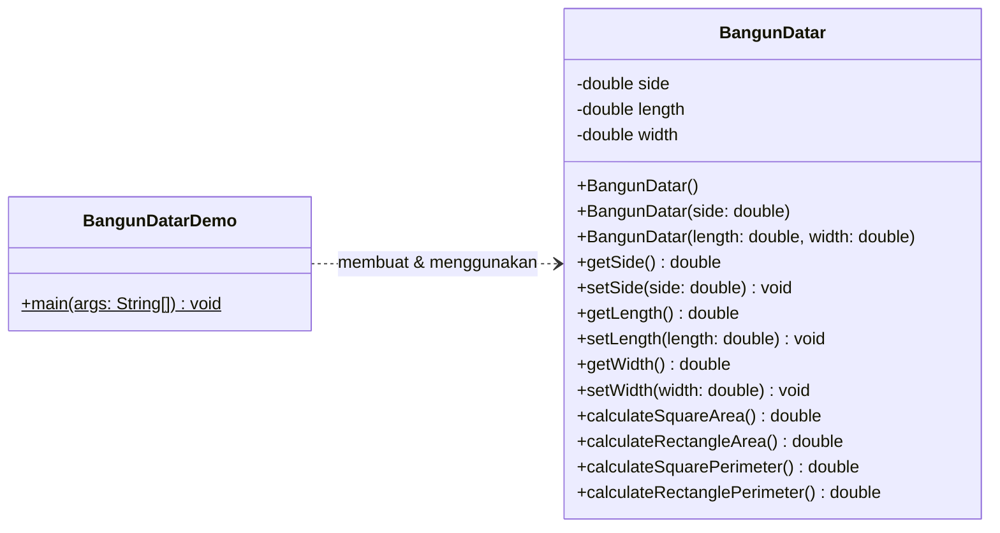
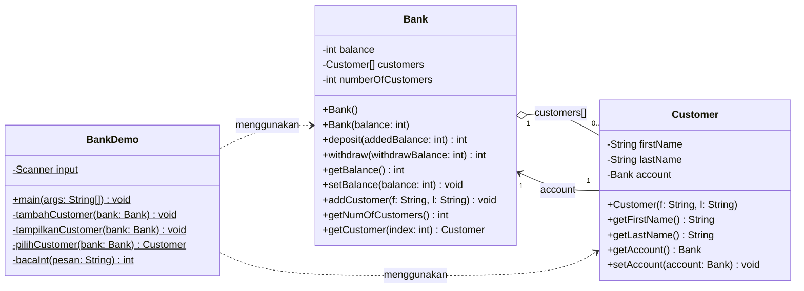
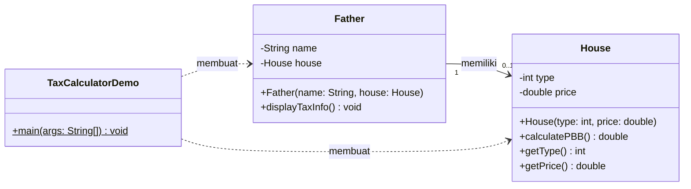
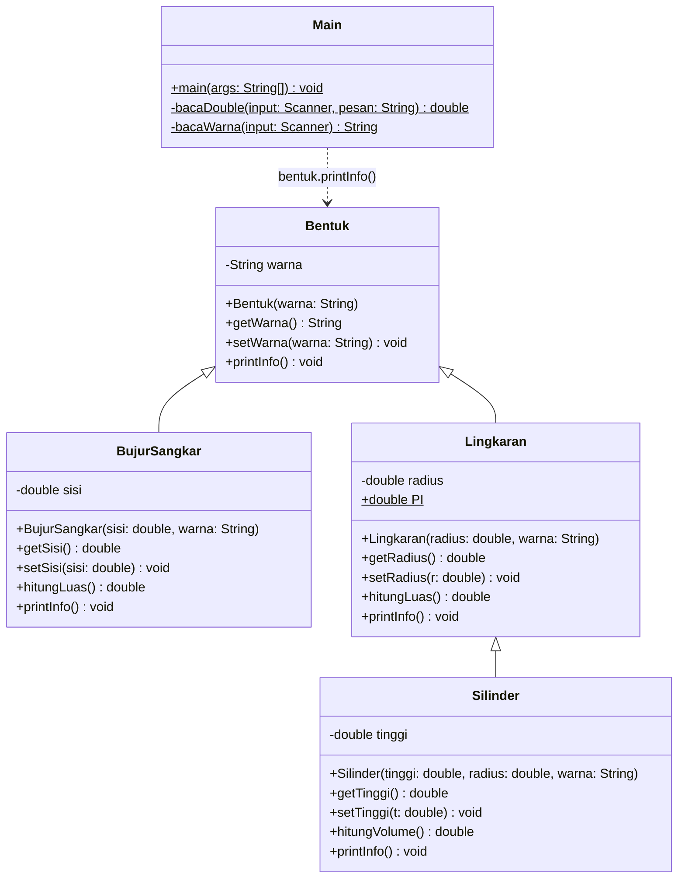

# OOP-Class-2026 — Latihan Pemrograman Berorientasi Objek (Java)

Repositori ini berisi kumpulan latihan (*exercise*) mata kuliah **Pemrograman Berorientasi Objek (PBO)** menggunakan bahasa **Java**. Setiap folder mewakili satu topik yang dibangun secara bertahap, mulai dari dasar pembuatan kelas dan objek hingga penerapan *inheritance* dan *polymorphism*.

| Exercise | Topik Utama | Kelas | Program Utama |
|:--:|---|---|---|
| 1 | Class, Object, Encapsulation, Constructor Overloading | `BangunDatar` | `BangunDatarDemo` |
| 2 | Array of Objects & Relasi Antar-Objek | `Bank`, `Customer` | `BankDemo` (menu interaktif) |
| 3 | Association / Composition (objek di dalam objek) | `House`, `Father` | `TaxCalculatorDemo` |
| 4 | Inheritance & Polymorphism | `Bentuk`, `BujurSangkar`, `Lingkaran`, `Silinder` | `Main` (menu interaktif) |

---

## Daftar Isi

- [Struktur Folder](#struktur-folder)
- [Cara Menjalankan](#cara-menjalankan)
- [Exercise 1 — Class & Object](#exercise-1--class--object)
- [Exercise 2 — Array of Objects](#exercise-2--array-of-objects)
- [Exercise 3 — Association Antar-Kelas](#exercise-3--association-antar-kelas)
- [Exercise 4 — Inheritance & Polymorphism](#exercise-4--inheritance--polymorphism)

---

## Struktur Folder

```text
OOP-Class-2026/
├── README.md
├── assets/
│   └── exercise2-array.png        # Gambar visualisasi array (Exercise 2)
│
├── Exercise1/                     # (default package)
│   ├── BangunDatar.java           # Kelas bangun datar (persegi & persegi panjang)
│   └── BangunDatarDemo.java       # Program utama / demo
│
├── Exercise2/                     # package Exercise2
│   ├── Bank.java                  # Akun bank + array Customer[]
│   ├── Customer.java              # Data nasabah + referensi akun (Bank)
│   └── BankDemo.java              # Program utama dengan menu interaktif
│
├── Exercise3/                     # package Exercise3
│   ├── House.java                 # Data rumah & perhitungan pajak PBB
│   ├── Father.java                # Pemilik rumah (memiliki objek House)
│   └── TaxCalculatorDemo.java     # Program utama / laporan pajak
│
└── Exercise4/                     # (default package)
    ├── Bentuk.java                # Superclass
    ├── BujurSangkar.java          # Subclass dari Bentuk
    ├── Lingkaran.java             # Subclass dari Bentuk
    ├── Silinder.java              # Subclass dari Lingkaran (pewarisan bertingkat)
    └── Main.java                  # Program utama dengan menu interaktif
```

---

## Cara Menjalankan

Pastikan **JDK 8 atau lebih baru** sudah terpasang (`java -version`).

> **Catatan:** `Exercise2` dan `Exercise3` menggunakan deklarasi `package`, sehingga harus dikompilasi dan dijalankan dari **root repositori**. Sementara `Exercise1` dan `Exercise4` tidak memakai `package`, sehingga dijalankan dari **dalam foldernya masing-masing**.

```bash
# Exercise 1 (tanpa package)
cd Exercise1
javac *.java
java BangunDatarDemo
cd ..

# Exercise 2 (package Exercise2) — dari root repositori
javac Exercise2/*.java
java Exercise2.BankDemo

# Exercise 3 (package Exercise3) — dari root repositori
javac Exercise3/*.java
java Exercise3.TaxCalculatorDemo

# Exercise 4 (tanpa package)
cd Exercise4
javac *.java
java Main
```

---

## Exercise 1 — Class & Object

### Tujuan
Memperkenalkan cara mendefinisikan **kelas**, membuat **objek**, serta menerapkan **enkapsulasi** melalui atribut `private` yang diakses menggunakan *getter* dan *setter*.

### Konsep yang Dipelajari
- **Encapsulation** — atribut `side`, `length`, dan `width` bersifat `private`.
- **Constructor Overloading** — tiga cara membuat objek `BangunDatar`:
  - `BangunDatar()` → konstruktor default, nilai diisi lewat *setter*.
  - `BangunDatar(double side)` → untuk persegi.
  - `BangunDatar(double length, double width)` → untuk persegi panjang.
- **Method** untuk menghitung luas dan keliling persegi maupun persegi panjang.

### Contoh Output

```text
--- Square ---
Area of square with side 7.0 = 49.0
Perimeter of square with side 7.0 = 28.0

--- Rectangle 1 ---
Area of rectangle with length 10.0 and width 5.0 = 50.0
Perimeter of rectangle with length 10.0 and width 5.0 = 30.0

--- Rectangle 2 ---
Area of rectangle with length 12.0 and width 6.0 = 72.0
Perimeter of rectangle with length 12.0 and width 6.0 = 36.0
```

### Class Diagram



---

## Exercise 2 — Array of Objects

### Tujuan
Latihan ini mensimulasikan sistem perbankan sederhana (**Bank ABC**) untuk mempelajari cara **menyimpan banyak objek di dalam sebuah array** dan mengelolanya melalui menu interaktif di terminal.

### Konsep Array of Objects (`Customer[]`)

Kelas `Bank` menyimpan daftar nasabah dalam sebuah **array bertipe objek**:

```java
private Customer[] customers;     // array berisi referensi objek Customer
private int numberOfCustomers;    // jumlah customer yang sudah terisi

public Bank() {
    customers = new Customer[10]; // kapasitas tetap: 10 slot
    numberOfCustomers = 0;        // awalnya belum ada customer
}
```

Hal penting yang perlu dipahami:

1. **Array hanya menyimpan referensi, bukan objeknya.** Saat `new Customer[10]` dijalankan, Java hanya menyiapkan 10 "slot" yang seluruhnya bernilai `null`. Objek `Customer` baru benar-benar dibuat ketika `addCustomer()` dipanggil.
2. **Ukuran array bersifat tetap.** Kapasitas `customers` adalah 10 dan tidak bisa bertambah secara otomatis (berbeda dengan `ArrayList`).
3. **`customers.length` ≠ jumlah customer.** `customers.length` selalu bernilai 10 (kapasitas), sedangkan jumlah data yang benar-benar terisi dicatat oleh variabel `numberOfCustomers`.

### Pengindeksan & Pelacakan Data (`numberOfCustomers`)

Variabel `numberOfCustomers` memiliki **dua peran sekaligus**:

| Peran | Penjelasan |
|---|---|
| **Penghitung** | Menyatakan berapa banyak customer yang sudah tersimpan (dikembalikan oleh `getNumOfCustomers()`). |
| **Penunjuk indeks kosong berikutnya** | Karena indeks array dimulai dari `0`, nilai `numberOfCustomers` selalu menunjuk slot kosong berikutnya. |

```java
public void addCustomer(String f, String l) {
    customers[numberOfCustomers] = new Customer(f, l); // isi slot kosong berikutnya
    numberOfCustomers++;                               // geser penunjuk ke slot berikutnya
}
```

Ilustrasi perubahan isi array ketika dua customer ditambahkan:

```text
Kondisi awal            numberOfCustomers = 0
index :   [0]    [1]    [2]   ...   [9]
isi   :  null   null   null   ...  null
           ▲
           └── slot berikutnya

addCustomer("Budi", "Santoso")    → customers[0] terisi, numberOfCustomers = 1
addCustomer("Siti", "Aminah")     → customers[1] terisi, numberOfCustomers = 2

index :   [0]      [1]     [2]   ...   [9]
isi   :  Budi     Siti    null   ...  null
                            ▲
                            └── slot berikutnya
```

Saat menampilkan data, perulangan dibatasi oleh `numberOfCustomers` (bukan `customers.length`) agar slot yang masih `null` tidak ikut diakses dan tidak memicu `NullPointerException`:

```java
for (int i = 0; i < bank.getNumOfCustomers(); i++) {
    Customer c = bank.getCustomer(i);
    ...
}
```

Pada menu pemilihan customer, nomor yang dimasukkan pengguna (dimulai dari **1**) dikonversi menjadi indeks array (dimulai dari **0**) dengan `bank.getCustomer(nomor - 1)`.

### Relasi Antar-Objek

Setiap `Customer` memiliki atribut `account` bertipe `Bank` yang berfungsi sebagai **rekening pribadi** customer tersebut. Artinya, kelas `Bank` dipakai dalam dua peran:

- Objek `Bank` **utama** (di `BankDemo`) → menampung array `Customer[]`.
- Objek `Bank` **per customer** → menyimpan `balance` (saldo) masing-masing, dibuat melalui `new Bank(saldoAwal)`.

### Visualisasi Alur Penggunaan Array


### Fitur Menu

| No | Menu | Keterangan |
|:--:|---|---|
| 1 | Tambah customer | Input nama depan, nama belakang, dan saldo awal |
| 2 | Tampilkan semua customer | Menampilkan seluruh isi array beserta saldonya |
| 3 | Deposit | Menambah saldo (jumlah harus > 0) |
| 4 | Withdraw | Mengurangi saldo (divalidasi agar tidak melebihi saldo) |
| 5 | Cek saldo customer | Menampilkan saldo satu customer |
| 0 | Keluar | Mengakhiri program |

### Contoh Output (Menu 2 — Tampilkan Semua Customer)

```text
========== MENU ==========
1. Tambah customer
2. Tampilkan semua customer
3. Deposit
4. Withdraw
5. Cek saldo customer
0. Keluar
Pilih menu: 2
Jumlah customer: 2
----------------------------------------
1. Budi Santoso - Saldo: Rp. 500000
2. Siti Aminah - Saldo: Rp. 250000
----------------------------------------
```

### Class Diagram



---

## Exercise 3 — Association Antar-Kelas

### Fokus Materi
Latihan ini berfokus pada **hubungan antar-kelas (association / *has-a relationship*)**, yaitu sebuah objek yang menyimpan objek lain sebagai atributnya. Objek `Father` **memiliki** sebuah objek `House`, lalu mendelegasikan perhitungan pajak kepada objek tersebut melalui `house.calculatePBB()`. Latihan ini juga melatih logika percabangan untuk menentukan tarif **Pajak Bumi dan Bangunan (PBB)** berdasarkan tipe rumah:

| Tipe Rumah | Tarif PBB |
|---|:--:|
| ≤ 36 | 4% |
| 37 – 45 | 6% |
| > 45 | 9% |

### Contoh Output

```text
=== Laporan Pajak PBB ===
Akbar | Tipe Rumah: 36 | Harga: Rp 3.0E8 | Pajak PBB: Rp 1.2E7
Bambang | Tipe Rumah: 45 | Harga: Rp 5.0E8 | Pajak PBB: Rp 3.0E7
Charlie | Tipe Rumah: 90 | Harga: Rp 1.0E9 | Pajak PBB: Rp 9.0E7
```

> **Tips:** Nilai bertipe `double` yang besar ditampilkan Java dalam notasi ilmiah (misalnya `3.0E8` = 300.000.000). Untuk tampilan yang lebih rapi dapat digunakan `String.format("%,.0f", nilai)`.

### Class Diagram



---

## Exercise 4 — Inheritance & Polymorphism

### Tujuan
Menerapkan dua pilar utama OOP, yaitu **Inheritance (Pewarisan)** dan **Polymorphism (Polimorfisme)**, melalui hierarki kelas bangun geometri yang dapat dipilih pengguna lewat menu interaktif.

### Hierarki Kelas

```text
Bentuk                      ← superclass (atribut: warna)
├── BujurSangkar            ← extends Bentuk    (tambahan: sisi)
└── Lingkaran               ← extends Bentuk    (tambahan: radius, PI)
    └── Silinder            ← extends Lingkaran (tambahan: tinggi)
```

### 1. Penerapan Inheritance (Pewarisan)

**a. Kata kunci `extends`**

Subclass mewarisi atribut dan method dari superclass-nya, sehingga tidak perlu menulis ulang kode yang sama.

```java
public class BujurSangkar extends Bentuk { ... }
public class Lingkaran    extends Bentuk { ... }
public class Silinder     extends Lingkaran { ... }   // pewarisan bertingkat (multilevel)
```

**b. Pemanggilan konstruktor superclass dengan `super(...)`**

Atribut `warna` bersifat `private` di kelas `Bentuk`, sehingga subclass tidak dapat mengisinya secara langsung. Oleh karena itu, subclass meneruskan nilai `warna` ke konstruktor induknya:

```java
public BujurSangkar(double sisi, String warna) {
    super(warna);        // inisialisasi bagian "Bentuk"
    this.sisi = sisi;    // inisialisasi bagian khusus BujurSangkar
}
```

Pada `Silinder`, rantai konstruktornya berjalan dua tingkat:

```text
new Silinder(tinggi, radius, warna)
   └─► super(radius, warna)   → konstruktor Lingkaran
          └─► super(warna)    → konstruktor Bentuk
```

**c. Akses atribut warisan melalui getter**

Karena `warna` bersifat `private`, subclass mengaksesnya melalui method warisan `getWarna()`. Ini menunjukkan bahwa **enkapsulasi tetap terjaga** meskipun terdapat pewarisan.

**d. Penggunaan ulang (reuse) method induk**

`Silinder` tidak menghitung ulang luas alas, melainkan memanfaatkan method `hitungLuas()` yang diwarisi dari `Lingkaran`:

```java
public double hitungVolume() {
    return hitungLuas() * tinggi;   // π × r² (dari Lingkaran) × tinggi
}
```

### 2. Penerapan Polymorphism (Polimorfisme)

**a. Method Overriding**

Setiap subclass mendefinisikan ulang method `printInfo()` milik `Bentuk` dengan anotasi `@Override`, sehingga masing-masing memiliki perilaku yang berbeda:

| Kelas | Isi `printInfo()` |
|---|---|
| `Bentuk` | `Bentuk berwarna <warna>` |
| `BujurSangkar` | `Bujursangkar berwarna <warna>, luas = <sisi²>` |
| `Lingkaran` | `Lingkaran <warna>, luas = <π·r²>` |
| `Silinder` | `Silinder warna <warna>, volume = <π·r²·t>` |

**b. Upcasting — referensi superclass menunjuk objek subclass**

Di `Main.java`, variabel bertipe **`Bentuk`** dapat menampung objek dari subclass mana pun:

```java
Bentuk bentuk = null;

switch (pilihan) {
    case 1: bentuk = new BujurSangkar(sisi, warna);          break;
    case 2: bentuk = new Lingkaran(radius, warna);           break;
    case 3: bentuk = new Silinder(tinggi, radius, warna);    break;
}
```

**c. Dynamic Method Dispatch (Runtime Polymorphism)**

Hanya ada **satu baris pemanggilan** untuk seluruh jenis bentuk:

```java
bentuk.printInfo();   // memanggil versi overriding sesuai objeknya
```

Meskipun tipe variabelnya `Bentuk`, JVM menentukan method mana yang dijalankan **saat runtime** berdasarkan **tipe objek sebenarnya**:

| Pilihan Menu | Tipe Variabel | Tipe Objek Sebenarnya | Method yang Dijalankan |
|:--:|---|---|---|
| 1 | `Bentuk` | `BujurSangkar` | `BujurSangkar.printInfo()` |
| 2 | `Bentuk` | `Lingkaran` | `Lingkaran.printInfo()` |
| 3 | `Bentuk` | `Silinder` | `Silinder.printInfo()` |

Keuntungannya, program utama tidak perlu mengetahui detail setiap bentuk. Jika kelak ditambahkan bentuk baru (misalnya `Segitiga extends Bentuk`), baris `bentuk.printInfo()` tidak perlu diubah sama sekali.

> **Catatan:** Method `hitungLuas()` hanya didefinisikan pada subclass, bukan pada `Bentuk`, sehingga tidak dapat dipanggil langsung melalui variabel bertipe `Bentuk` (misalnya `bentuk.hitungLuas()` akan menghasilkan *compile error*). Karena itulah perhitungan luas/volume dipanggil dari dalam `printInfo()` masing-masing subclass.

### Contoh Output Program

**Memilih opsi 1 — Bujur Sangkar**

```text
===== MENU BENTUK =====
1. Bujur Sangkar
2. Lingkaran
3. Silinder
0. Keluar
Pilih bentuk: 1
Masukkan sisi: 5
Masukkan warna: Merah
--- Hasil ---
Bujursangkar berwarna Merah, luas = 25.0
```

**Memilih opsi 2 — Lingkaran**

```text
===== MENU BENTUK =====
1. Bujur Sangkar
2. Lingkaran
3. Silinder
0. Keluar
Pilih bentuk: 2
Masukkan radius: 7
Masukkan warna: Biru
--- Hasil ---
Lingkaran Biru, luas = 153.93791
```

**Memilih opsi 3 — Silinder, lalu keluar**

```text
===== MENU BENTUK =====
1. Bujur Sangkar
2. Lingkaran
3. Silinder
0. Keluar
Pilih bentuk: 3
Masukkan radius: 7
Masukkan tinggi: 10
Masukkan warna: Hijau
--- Hasil ---
Silinder warna Hijau, volume = 1539.3790999999999

===== MENU BENTUK =====
1. Bujur Sangkar
2. Lingkaran
3. Silinder
0. Keluar
Pilih bentuk: 0
Program selesai.
```

> **Tips:** Angka `1539.3790999999999` muncul karena keterbatasan presisi tipe `double` (*floating-point*). Untuk membulatkan tampilan dapat digunakan `String.format("%.2f", hitungVolume())`.

Program juga memvalidasi input: jika pengguna memasukkan huruf pada saat diminta angka, program akan meminta input ulang (`Input harus angka. ...`) alih-alih berhenti dengan error.

### Class Diagram



---

<p align="center">Dibuat untuk keperluan pembelajaran mata kuliah Pemrograman Berorientasi Objek — 2026</p>
